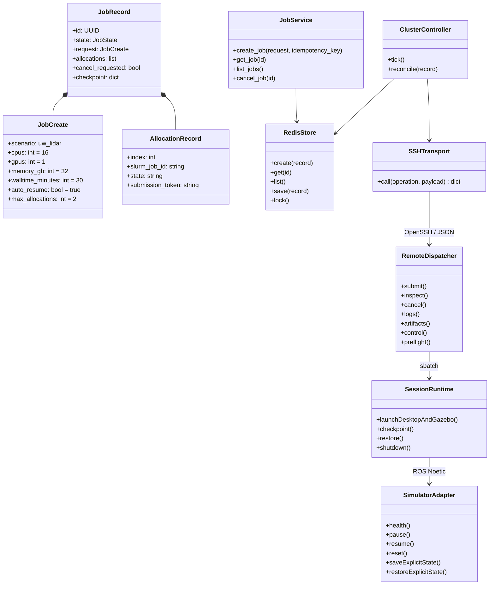
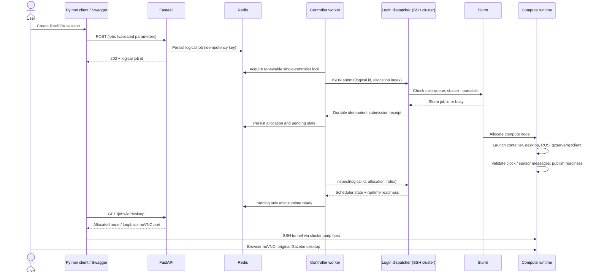
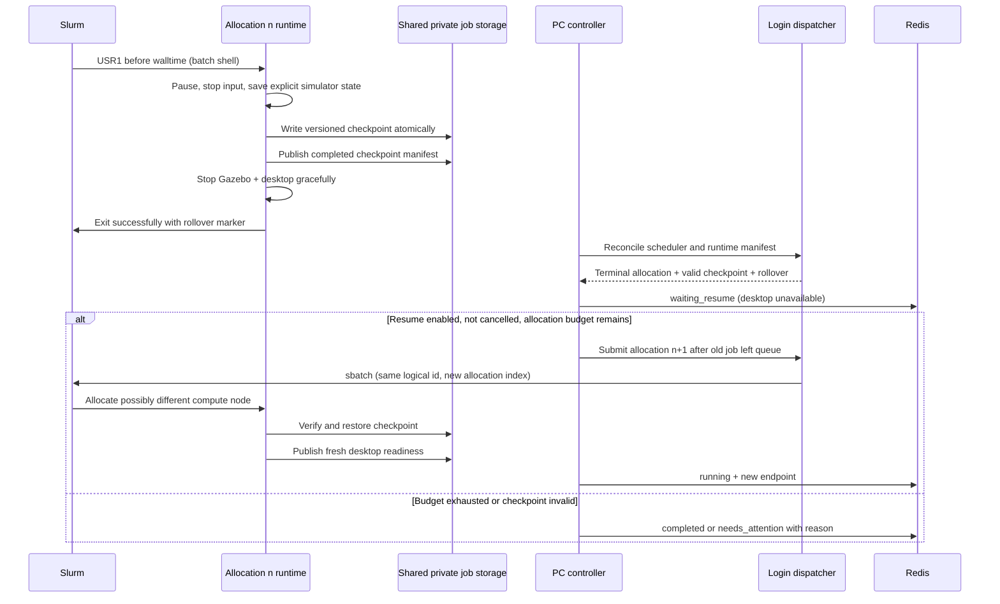

# Architecture and UML

## Components / class diagram

## Launch and desktop sequence

## Rollover sequence

### Invariants

- A lost SSH response is not permission to blindly submit again: reconcile with deterministic job name/comment and shared submission receipt.
- Cancellation is durable and dominates automatic renewal.
- `squeue` absence alone does not prove success. Consult `sacct`/`scontrol` and runtime manifests; missing accounting becomes unknown/needs_attention, not completed.
- Never create allocation n+1 while allocation n is active/COMPLETING or any incompatible user job consumes the one-job submit quota.
- Redis/API restart must not erase logical sessions or duplicate a remote allocation.
